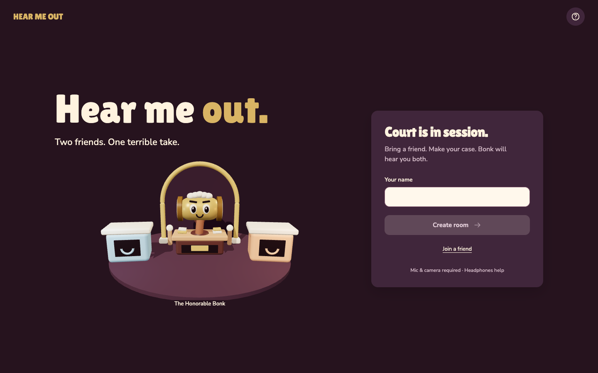
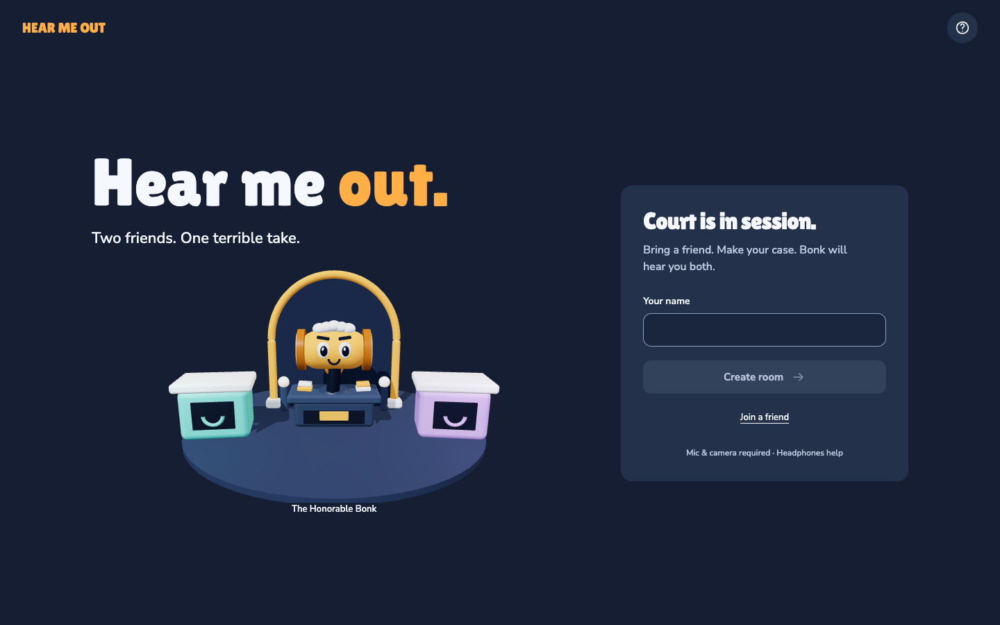
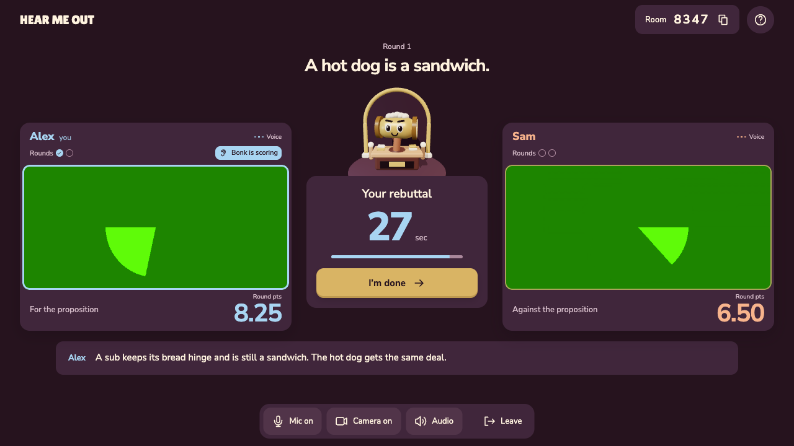
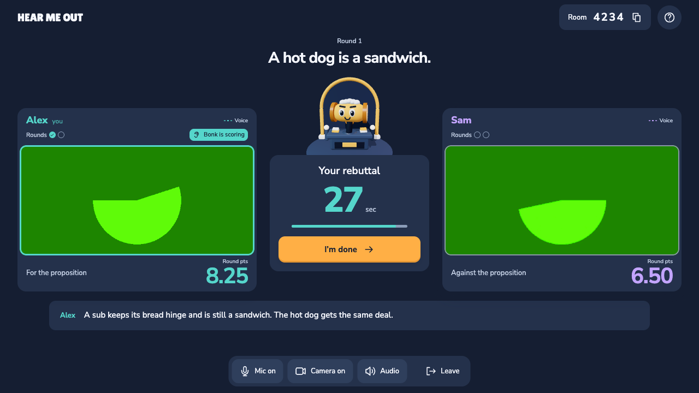
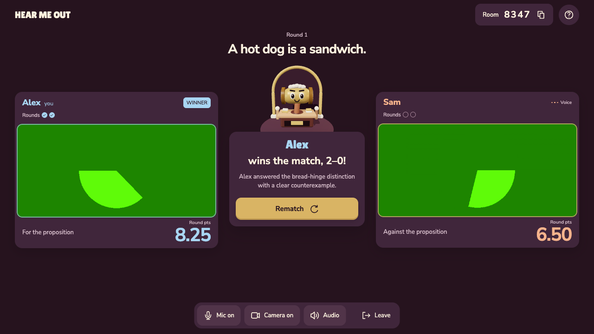
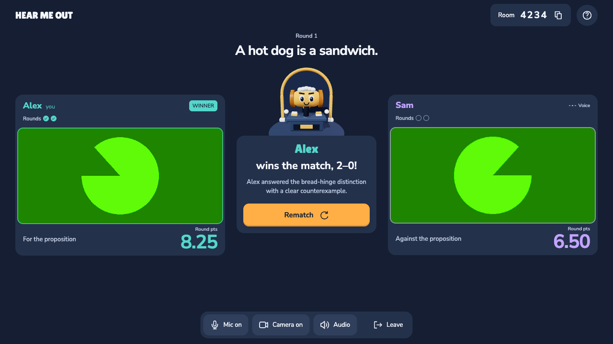
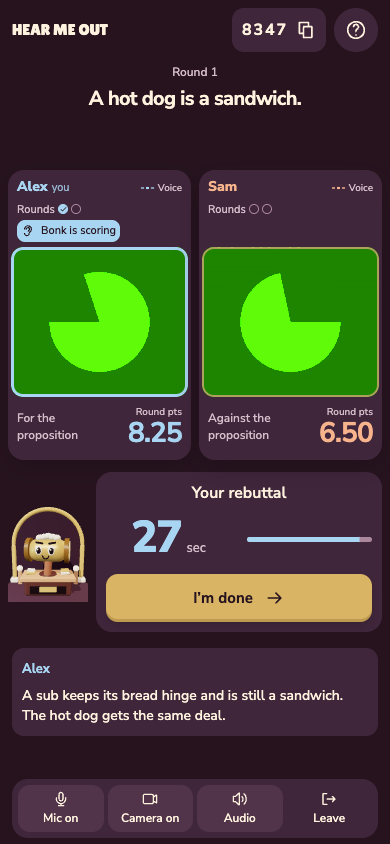
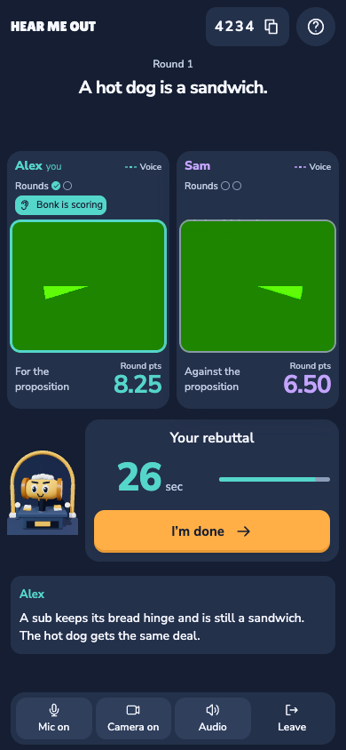

# Tangerine Arcade verification

Presentation-only follow-up to `d79aeb26cda930a7fed57e8b24989dd8f22e9e90`, the head of [draft redesign PR #4](https://github.com/arazfar/hear_me_out/pull/4). The implementation branch is `codex/tangerine-arcade`, stacked on `codex/velvet-verdict`. No gameplay, protocol, provider, database, media pipeline, geometry, typography, or dependency changes are included.

## Before and after

These are fresh screenshots of running builds. Before uses the rebuilt `d79aeb2` frontend; after uses Tangerine Arcade. Green feeds are **synthetic test players**, not human participants. Room codes, clocks, and generated camera frames vary between captures.

| Surface | Before | After |
| --- | --- | --- |
| Entry, 1440×900 |  |  |
| Debate, 1280×720 |  |  |
| Verdict, 1280×720 |  |  |
| Debate, 390×844 |  |  |

Additional matching captures: [360px before](before/verdict-360.png) / [after](after/verdict-360.png), and [landscape before](before/debate-844.png) / [after](after/debate-844.png). Landscape uses document scrolling so controls do not cover the faces or task. [WebGL fallback](after/webgl-fallback-390.png) uses the regenerated procedural Bonk image.

## Implementation and accessibility

`src/design/tokens.ts` owns semantic surface, text, action, identity, status, scene, and lighting roles. CSS variables and the favicon are emitted by the theme-neutral Vite plugin. React identity helpers and Three.js consume those definitions. The palette is not duplicated in an alternate theme, and obsolete hue aliases were removed. Bonk uses a matte tangerine body, ice-white wig, midnight features, painted-blue furniture, an ice-white key light, and restrained warm rim light. Existing geometry, animation triggers, DPR ceiling 1.5, and degraded DPR 1 remain.

Seat 0 stays turquoise and seat 1 lilac across both client perspectives, outcomes, departure, reconnect, and rematch. Names and stable positions reinforce identity. Intentional mic/camera privacy is neutral; actual failures use error styling. Voice activity and scoring eligibility retain their separate labels/icons. Inputs and native selectors use the dark color scheme. Focus uses a 3px ice-white ring separated by a 2px midnight gap, including during hover/press.

[Surface measurements](surface-checks.json) cover 20 state families at 1440×900, 1280×720, 360×640, 390×844, and 844×390: entry, joining, private setup, lobby, coin, topic selection/custom topic/agreement, debate, judging, round result, verdict, rematch, recovery, interruption, rules, sound, judge speaking/muted captions, and WebGL fallback. All 100 combinations passed sampled composited text/placeholder contrast, 44px target, essential indicator, and horizontal overflow checks. [Interaction measurements](interaction-checks.json) cover disabled, keyboard-focus, hover, and pressed states. Existing behavioral checks retain keyboard completion, modal focus containment/restoration, phase announcements without tick repetition, reduced motion, complete long content, reward collision protection, mounted media, privacy, and playback accounting. The lowest sampled text contrast was 5.29:1, and the lowest measured essential boundary was 4.72:1. This is focused coverage, not a claim of complete WCAG conformance.

Grayscale and protanopia/deuteranopia/tritanopia simulations were captured for debate and verdict at desktop and phone sizes. See [grayscale verdict](after/verdict-achromatopsia-390.png) and [deuteranopia debate](after/debate-deuteranopia-390.png). Colors become less distinct in some simulations; names, positions, scores, checks, and the ear-plus-“Bonk is scoring” label continue to carry the meaning.

## Validation record

- Pinned Node 24.21.0 and pnpm 10.12.1; local macOS/Apple silicon, Chrome and Playwright WebKit.
- `pnpm check`: passed.
- `pnpm test`: 252 passed, 0 failures.
- `pnpm build`: passed. The existing lazy Three.js bundle still exceeds Vite's 500 kB advisory threshold.
- Initial atlas and phone-reflow checks: 2 passed in 36.9 seconds. Confirmation with the rebuilt fallback: 1 atlas passed in 36.8 seconds. The final expanded atlas passed in 31.1 seconds in the restarted full run.
- Both fresh baseline and Tangerine long-judge/media comparisons passed, with asymmetric delivery, explicit Bonk mute, channel repair, complete sample accounting, and continuous friend output.
- The draft PR records final results and attempt history for `pnpm test:ui` across `rtc`, `relay`, `phone`, `phone-relay`, `webkit`, and `webkit-relay`, together with hosted CI status. No behavioral assertion or production deadline was relaxed.

Run history: an initial full matrix was deliberately interrupted for that caption-color correction after 3 passes, with 1 interrupted test and 52 not run. The full matrix was restarted against the corrected build.

Evidence-tool corrections: the first comparison server invocation resolved the repository root rather than the archived build directory; that comparison was discarded, and its in-flight media run was interrupted when the server was replaced. The valid comparison checks distinct built asset hashes before measuring. A Chromium screenshot taken before repaint after changing vision emulation was recaptured with two animation frames of settling. Neither issue changed product behavior.

The independent Impeccable review approved the presentation-only scope, then identified one routine-caption status color mismatch during documentation review. “Speaking,” “Sound off,” and other routine playback labels now use neutral secondary text; all predicates and labels remain unchanged. The atlas additionally captures both speaking and muted judge captions at all five sizes. The reviewer scored this correction **resolved**, returning **ship** for that fix. See the [review record](review.md). The detector returned no findings. Active design documentation and the schemaVersion2 sidecar are updated to the implemented semantic system.

## Performance and media

[Render measurements](performance.json): 300 animation frames after two seconds of warmup, headless desktop Chrome, 1280×720 title scene. Median interval was 16.7 ms before and after; p95 was 16.7/16.8 ms. Both used one canvas, nine resource requests, and normal quality. Transfer size was 1,515,899/1,516,121 bytes. Sampled JS heap was 10.94/11.81 MB; main-thread task time during the sample was 0.425/0.533 seconds. These single-run timing and heap samples include runtime noise and do not establish typical-device FPS or a memory trend.

[Media comparison](media-comparison.json): the unchanged judge-render assertions passed before and after. Each client completed the full utterance, including its final partial frame, and repaired judge playback. Baseline friend-output probes sampled 189/195 intervals; Tangerine sampled 188/195. Neither observed a silent interval; minimum RMS remained above 0.0848 and maximum tone-frequency error was 1.875 Hz. These synthetic probes establish the tested progress/continuity behavior, not acoustic quality.

## Assets and remaining release work

`public/bonk-fallback.png` is an isolated screenshot of the finished Three.js scene, with embedded provenance, not an AI illustration or player image. Regenerate deliberately with `EXPORT_BONK_FALLBACK=true pnpm test:ui --project=rtc -g 'Tangerine Arcade'`, then rebuild before reviewing the fallback. Ordinary tests never mutate the shipped asset.

Live-provider checks (`verify:providers`, `verify:judge`, `verify:match`, `verify:idle`), physical Android/iPhone testing, acoustic echo/headphone evaluation, adverse real-network/TURN checks, and first-time-player research are not established by this palette work. They remain release gates. No live-provider calls, merge, deployment, or release were performed. The broad-appeal and extended-comfort goals remain hypotheses for human playtests.
