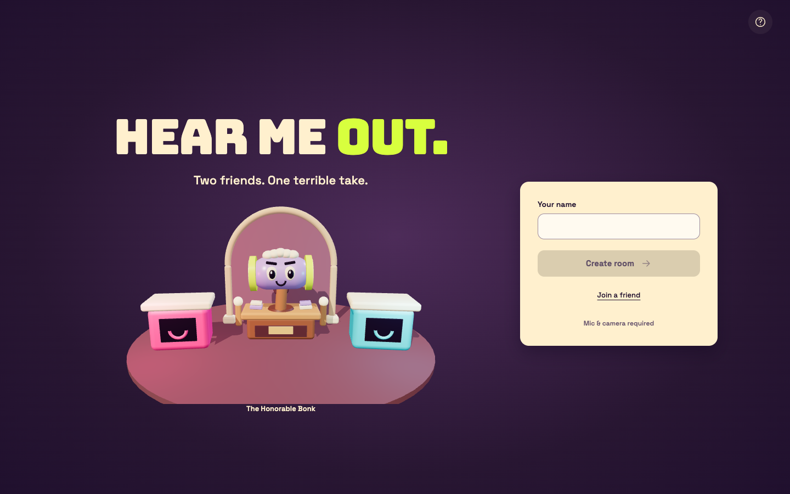
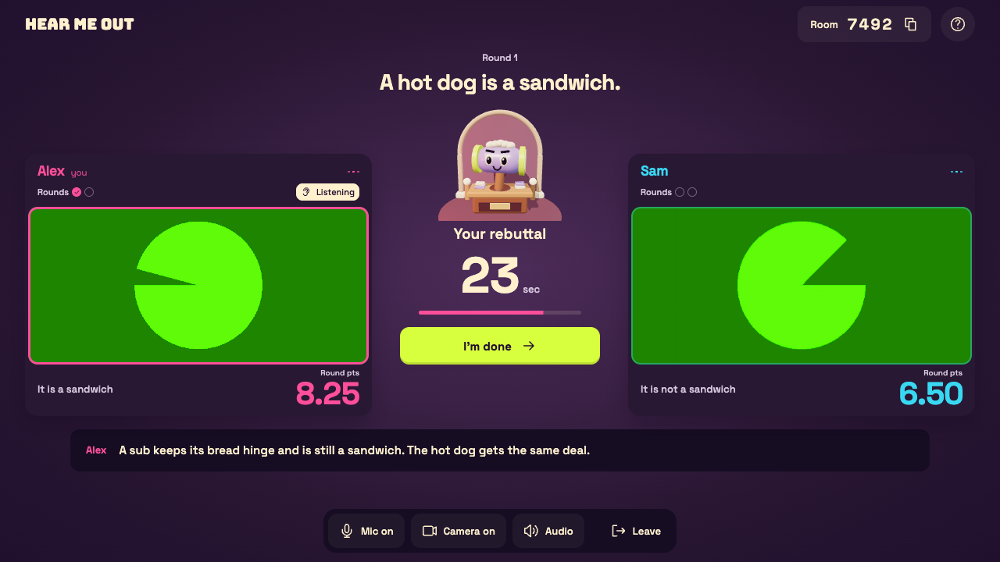
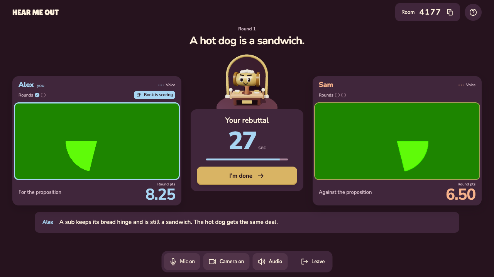
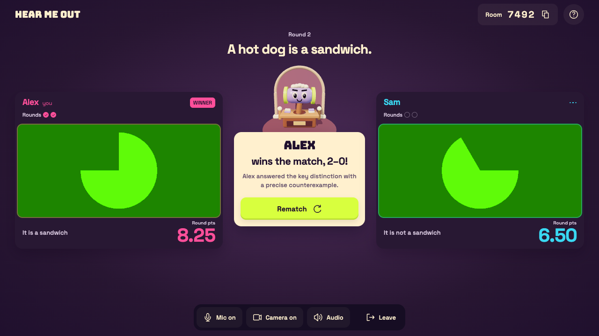
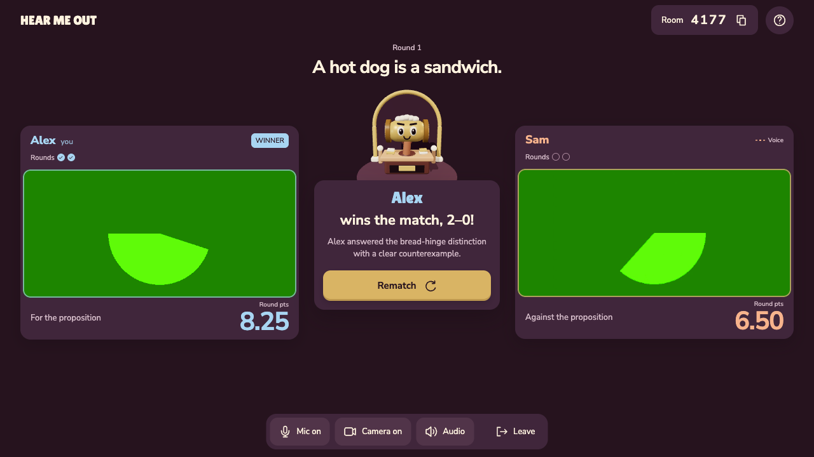
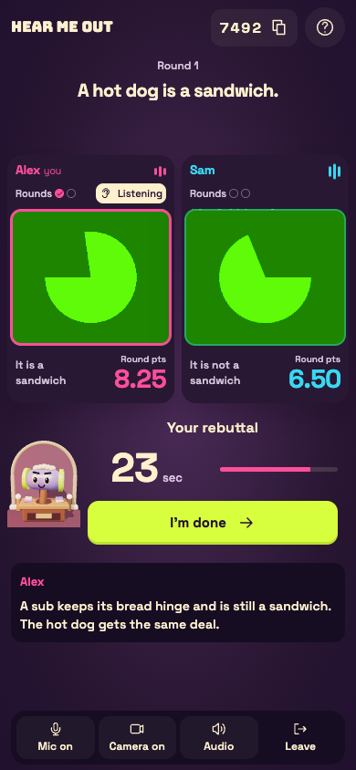
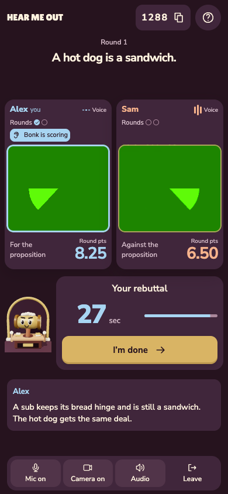

# Velvet Verdict verification

The implementation starts at `c19a0e71b32d74ff0e58b44f6cb1e77ef0ea0d47` on `main`. Only the [palette image](https://github.com/arazfar/hear_me_out/blob/design/velvet-verdict-reference/docs/design/velvet-verdict/palette.png) was read from the design branch. Hear Me Out and the Honorable Bonk retain their product identities.

## Before and after

These are fresh captures of running builds, not illustrative comps. Green camera feeds are Chrome's **synthetic test media**, not human players. Before captures use the base commit; after captures use this implementation. Room codes and generated feed frames differ between runs.

| Surface           | Before                                        | After                                                |
| ----------------- | --------------------------------------------- | ---------------------------------------------------- |
| Entry, 1440×900   |         |         |
| Debate, 1280×720  |       |       |
| Verdict, 1280×720 |     |     |
| Debate, 390×844   |  |  |

Additional after captures: [360px verdict](after/verdict-360.png), [844×390 landscape document](after/debate-844.png). Landscape intentionally scrolls with controls in document flow, preventing a fixed dock from covering faces or task content.

## Validation

- Node 24.21.0, pnpm 10.12.1, Playwright 1.64.0, macOS 26.6.2 on Apple silicon.
- `pnpm check`: passed.
- `pnpm test`: 252 passed, 0 failures.
- `pnpm build`: passed; existing lazy Three.js bundle remains above Vite's 500 kB advisory threshold.
- Focused phone-layout and Velvet Verdict state-atlas checks: 2 passed in 34.4 seconds after the final review fixes.
- Full `pnpm test:ui` six-project matrix and hosted CI: final run counts, outcomes, and links are recorded in [draft PR #4](https://github.com/arazfar/hear_me_out/pull/4).

The atlas covers 17 surface/state families at 1440×900, 1280×720, 360×640, 390×844, and 844×390. [Surface measurements](surface-checks.json) record actual composited text contrast, 44px target dimensions, and horizontal overflow. All 85 captured combinations passed those checks; the lowest sampled text ratio was 5.50:1. This is focused coverage, not a claim of complete WCAG conformance. Existing acceptance tests retain keyboard/focus restoration, single-owner announcements, full long captions and punctuation, reduced motion, persistent video elements, reward collisions, private checks, recovery, and rematch assertions. The new identity checks exercise both client perspectives, either winner, array reordering, departure, vacant-seat replacement, reconnect, and rematch.

The independent design review required a landscape dock correction and visible phone voice labels. Both were corrected and the reviewer scored them resolved. The documenter verified the token-bearing DESIGN.md and schemaVersion2 sidecar; the reviewer then scored all three original findings resolved (disposition: ship, limited to those findings).

## Performance and media limits

[Local render sample](performance.json): 300 animation frames after a two-second warmup at 1280×720 in headless desktop Chrome. Before and after both measured a 16.7ms median and 16.8ms p95 interval, one canvas, and normal scene quality. Measured heap was about 11.0 MB before and 11.1 MB after; sampled main-thread task time was 0.52s and 0.50s respectively. This narrow title-scene sample does not establish typical-device FPS, audio quality, or end-to-end judge latency.

The complete-match suite checks actual captured/rendered progress using synthetic media and mock providers. No provider adapters, media queues, worklets, clock rules, score ledger, or playback completion thresholds were weakened. Appearance changes keep the persistent player slots and the existing DPR/quality downgrade limits.

## Assets and regeneration

`src/design/tokens.ts` supplies CSS custom properties, Three.js colors/materials/lighting, and the generated favicon through Vite. `public/bonk-fallback.png` is a direct capture of the final procedural scene, with no player imagery. Its embedded PNG provenance records its source and capture method; it is not an AI-generated illustration.

To regenerate the fallback after an intentional scene change:

```sh
pnpm build
EXPORT_BONK_FALLBACK=true TEST_RTC_PORT=3212 TEST_RELAY_PORT=3213 pnpm test:ui --project=rtc -g 'Velvet Verdict'
# Inspect public/bonk-fallback.png, update its embedded provenance, then rebuild.
pnpm build
```

Normal test runs never overwrite the shipping asset. Full atlas screenshots and measurements are under `output/playwright/velvet-verdict/after/`, retained by CI. Selected review images are committed here.

## Remaining release checks

Provider credentials were unavailable in this worktree, so live OpenAI/Cartesia/Fish provider rehearsal was not run. Physical-device access was not used. Live provider rehearsal, physical two-player matches on desktop Chrome/Android Chrome/iPhone Safari, acoustic balance, real mobile interruptions, separate-network RTC/forced-relay behavior, and production TURN coverage remain unverified by this redesign. Synthetic browser media cannot establish those outcomes. Existing hosting, capacity, durability, abuse/quota, and retention limits in the product documentation remain separate release work.

No merge or deployment is part of this change. The optional additive player `seat` field keeps existing command shapes and protocol version 4; legacy snapshots without it retain array-order identity. No data migration is required. Revert the implementation and rebuild the matching client/server artifacts for rollback, following the repository's release instructions.
